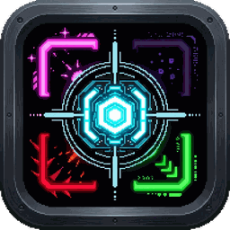

<p>
  
  <h1>SECTOR 404</h1>
  <p>
    FPS 3D em ASCII colorido escrito em C11 com Raylib e shaders GLSL, feito pela equipe <strong>404 NF</strong> para a disciplina de Linguagem de Programacao (Engenharia da Computacao).
  </p>
</p>
<br clear="left"/>

## Baixar e Jogar (Windows)

**[Baixar sector404.exe (v1.0 - Windows x64, 1.6 MB)](https://github.com/puppet04/ascii-doom-c/releases/latest/download/sector404.exe)** | [Ver pagina de Releases](https://github.com/puppet04/ascii-doom-c/releases)

O executavel ja vem autocontido: Raylib linkada estaticamente, sem DLLs externas e com as 5 fases e o icone embutidos direto no binario. Basta baixar e abrir o `sector404.exe`.

> **Nota do Windows SmartScreen:** por ser um executavel compilado pelo grupo sem certificado digital comercial, o Windows pode mostrar *"O Windows protegeu o computador"*. Se aparecer, clique em **Mais informacoes** > **Executar assim mesmo**.

---

## Sobre o Jogo

- **Motor ASCII 3D na GPU:** raycasting DDA em tempo real, dois estilos visuais (`F4` alterna entre **Sobreposto** e **Micro-ASCII**), cinco niveis de qualidade (`F2`: Baixo, Medio, Alto, Ultra e Auto), camera em 1a ou 3a pessoa (`V`), movimento por Delta Time e limite de FPS ajustavel (`F3`: 60, 165 ou ilimitado).
- **5 Fases Editaveis (`assets/maps/level1.txt` a `level5.txt`):** cenarios em texto puro com paredes tematicas, armadilhas de fogo (`^`/`F`), kits medicos (`+`), portais de saida (`E`) liberados ao limpar a fase e areas opcionais de bosses.
- **9 Armas e 4 Bosses Secretos:**
  - Arsenal principal: **Pistola** (reserva infinita), **Shotgun**, **Sniper**, **Metralhadora** e **Rifle Futurista**.
  - Armas de boss (dropadas pelos 4 bosses de arena): **Maquita** (corpo a corpo), **Revolver**, **Tommy Gun** e **Lanca-Chamas**.
  - Municao finita por pente/reserva, troca pelo **scroll do mouse**, tecla `F` ou `1`–`9`, e torre de inventario no canto direito do HUD (armas com pente e reserva zerados somem da torre).
- **5 Personagens + Criador de Skins:**
  - **Fuzileiro:** classe padrao balanceada.
  - **Kasane Teto:** `E` cria uma zona rosa no chao (10s, raio de 3 blocos) com +35% de velocidade e +25% de dano enquanto estiver dentro (cooldown de 30s).
  - **Arauto das Sombras:** `E` dispara uma bola de fogo negra (5 de dano no impacto + 2 de dano/s por 5s, cooldown de 30s).
  - **Guts:** apos 5 kills, `E` ativa o modo Berserk por 10s (1 vez por partida) com a espada Dragonslayer corpo a corpo (abate em 1 golpe sem gastar municao, mas recebe dano dobrado).
  - **Rambo:** passiva Guerrilheiro — apos 5s sem levar dano, o proximo tiro causa dano dobrado.
  - **Criador de skins (`+ Criar skin` ou `N`):** monta ate 8 personagens customizados por sessao (cabeca, corpo, cabelo, roupa, cores e tom de pele), exibidos no menu, HUD, 3a pessoa e multiplayer.
- **Multiplayer LAN e Online (ate 4 jogadores):** suporta **Co-op** e **PvP** em rede local (UDP com descoberta automatica de salas na LAN) ou pela internet via nosso servidor Relay WebSocket (`relay/server.js`, em `wss://sector404-relay.onrender.com`), sincronizando posicao, skin, tiros e combates.

---

## Controles

| Tecla / Botao | Acao |
| :--- | :--- |
| `W` `A` `S` `D` | Movimentacao (diagonal normalizada) |
| `Shift` | Correr (Sprint) |
| `Mouse`, `Q` ou `Setas` | Girar camera 360° e olhar na vertical |
| `Clique Esquerdo` ou `Espaco` | Atirar / golpear |
| `Scroll do Mouse`, `F` ou `1`–`9` | Trocar arma na torre de arsenal |
| `R` | Recarregar pente |
| `E` | Ativar habilidade do personagem |
| `V` | Alternar camera entre 1a e 3a pessoa |
| `TAB` | Soltar / travar o cursor do mouse |
| `F2` | Alternar qualidade ASCII (`BAIXO` / `MEDIO` / `ALTO` / `ULTRA` / `AUTO`) |
| `F3` | Alternar limite de FPS (`60` / `165` / `ILIMITADO`) |
| `F4` | Alternar estilo visual (`Sobreposto` / `Micro-ASCII`) |
| `F11` | Tela cheia sem bordas |
| `ESC` | Pausar / voltar ao menu |

*(Todas as teclas principais tambem podem ser reconfiguradas no menu **Configuracoes** do jogo.)*

---

## Como Compilar e Testar (Windows)

O build usa GCC (MSYS2 UCRT64) + Raylib linkada estaticamente. Se a Raylib nao estiver instalada no MSYS2, o `build.bat` tenta instalar via `pacman` automaticamente.

```powershell
# Compilar o executavel em bin/sector404.exe
.\build.bat

# Compilar e abrir o jogo
.\build.bat run

# Rodar a suite de testes automatizados (173 verificacoes)
.\build.bat test

# Limpar arquivos gerados em bin/
.\build.bat clean
```

No VS Code, voce tambem pode apertar `Ctrl + Shift + B` para rodar a task de compilacao (`.vscode/tasks.json`). Veja o passo a passo de ambiente em [`docs/GUIA_GITHUB_E_AMBIENTE.md`](docs/GUIA_GITHUB_E_AMBIENTE.md).

---

## Equipe 404 NF e Organizacao do Codigo

| Integrante | Branch | Modulo | Principais Responsabilidades |
| :--- | :--- | :--- | :--- |
| **Rafael Strazzer** | `strazzer` | `player.h` / `player.c` | 5 personagens base, habilidades, criador de skins e fisica |
| **Lucas** | `lucas` | `map.h` / `map.c`, `assets/maps/` | 5 fases `.txt`, materiais, armadilhas, kits, portas e colisao |
| **Guilherme Trentin** | `guilherme` | `entities.h` / `entities.c` | 9 armas, 4 bosses secretos, drops, IA com BFS e inimigos |
| **Guilherme Checchia** | `checchia` | `renderer.*`, `render_api.h`, `network.*`, `main.c`, `relay/` | Motor ASCII GPU, HUD/menus, otimizacoes e multiplayer LAN/Online |

---

## Documentacao

- [`docs/ARQUITETURA_DO_CODIGO.md`](docs/ARQUITETURA_DO_CODIGO.md) — estrutura de pastas, game loop, Delta Time, pipeline GPU e rede
- [`docs/GUIA_LIB_RENDERIZACAO.md`](docs/GUIA_LIB_RENDERIZACAO.md) — referencia da `RendererApi` e hooks de mapa/sprites
- [`docs/GUIA_GITHUB_E_AMBIENTE.md`](docs/GUIA_GITHUB_E_AMBIENTE.md) — configuracao do MSYS2, Raylib, Git e fluxo de branches
- [`docs/ETAPA1_DOCUMENTO_BASE.md`](docs/ETAPA1_DOCUMENTO_BASE.md) — resumo do escopo e entrega da disciplina
